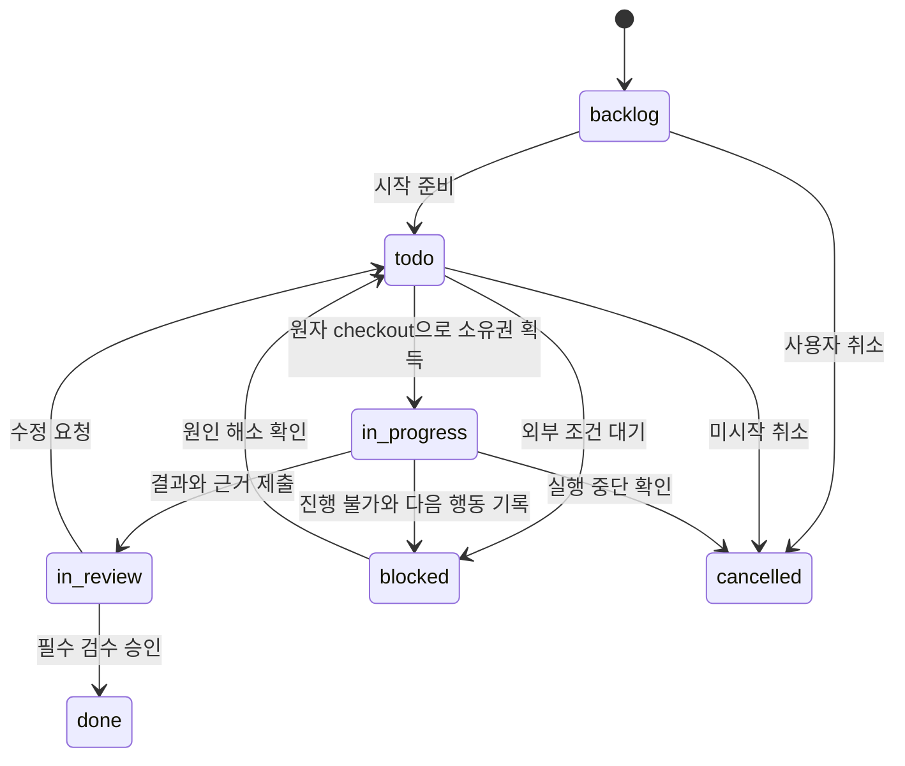
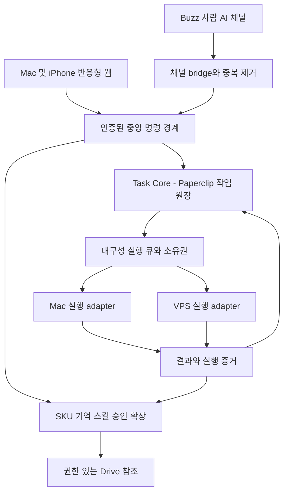

# HAAR 쇼핑몰 AI 작업 플랫폼 PRD

- 문서 버전: 0.1 / 2026-10-16
- 상태: 사용자 합의를 바탕으로 작성한 검토용 초안. 구현·배포 완료 문서가 아님.
- 프로젝트: HAAR Workspace. SELLAYER와 별도 저장소·권한·데이터 경계를 유지한다.
- 독자: 쇼핑몰 운영자, 제품·디자인·개발 담당자, 실행 adapter 담당자.
- 범례: **[확정] 사용자 합의**, **[제안] 기술·제품 설계**, **[미확인] 증거 또는 결정이 필요한 항목**.
- 상세 계약: [adapter](ADAPTER_CONTRACT.md), [보안·승인](SECURITY_APPROVALS.md), [수용기준](ACCEPTANCE_CRITERIA.md), [기술 근거](TECHNICAL_REVIEW.md).

## 1. 해결할 문제

**[확정]** 사진, 상세페이지, 착용샷, 영상, SNS, 광고 업무가 여러 GPT 세션과 dot, MacOrca의 Codex·Antigravity·OpenCode, VPS의 Hermes·OpenClaw 및 Telegram에 흩어져 있다. 사용자는 대화를 다시 읽으며 현재 상태, 결정 이유, 다음 행동, 산출물 위치를 재구성해야 한다. “AI가 답했다”와 “실제로 작업이 끝났다”와 “게시해도 된다”도 섞인다.

새 제품의 중심 질문은 다음과 같다.

1. 오늘 가장 중요한 세 가지와 마감은 무엇인가?
2. 지금 누가, 어느 기기에서, 어느 지침과 스킬로 실행 중인가?
3. 무엇 때문에 멈췄고 다음 행동의 책임자는 누구인가?
4. 이 SKU의 최신 승인 결과물과 그 근거는 어디에 있는가?
5. 외부에 무엇이 나갔으며 누가 어떤 버전을 승인했는가?

## 2. 제품 목표와 성공 지표

**[확정]** 첫 제품은 VPS 중앙 반응형 웹이다. iPhone 전용 앱보다 웹에서 지시·집중관리·검토·승인을 먼저 제공한다. AI 작업 지시까지 포함하고, 단순 대화 보관함에서 끝내지 않는다.

| 목표 | 요구 결과 | 초기 측정 목표 [제안] |
| --- | --- | --- |
| 집중관리 | 홈에서 오늘 집중·우선순위·마감·막힘을 함께 판단 | 운영자가 1분 안에 다음 할 일을 선택하는 사용성 검증 |
| 상태 신뢰 | 작업·실행·검수·외부 행동이 서로 연결 | 진행 중 작업 100%에 실행 경로 또는 책임자·다음 행동 존재 |
| 인계 비용 감소 | 새 AI가 결정·원본·승인 버전을 이어받음 | 선정한 5개 인계 시나리오에서 누락된 필수 맥락 0건 |
| 결과 재발견 | SKU에서 원본부터 최종 승인까지 조회 | SKU 검색 후 3번 이내 주요 조작으로 승인 결과 열기 |
| 실행 안전 | 중복·오프라인·불확실 완료를 구분 | 중복 이벤트·연결 단절 시나리오에서 중복 외부 실행 0건 |
| 승인 신뢰 | 승인한 정확한 대상·버전만 실행 | 무승인·변조·만료·재사용 승인 시나리오 모두 차단 |

초기 운영 2주 동안 현재의 작업 누락·재설명 시간·검수 소요시간을 기준선으로 측정한다. 위 수치는 합의된 SLA가 아니라 수용시험 제안이다. AI 비용은 제공자가 보고한 값과 추정치를 구분하고, 값이 없으면 0원 대신 ‘미집계’로 표시한다.

## 3. 범위와 비목표

### 3.1 이번 문서 작업의 범위

**[확정]** 이 PR은 요구사항·계약·검증 기준만 작성한다. 구현 코드, VPS 접속·설치·재시작, Cafe24 변경, 실제 게시·광고 변경·CS 발송, 비밀 CSV 이관을 실행하지 않는다. 기존 서버 Paperclip 설치 여부·버전·설정·데이터는 미검증이다.

### 3.2 제품의 업무 영역

| 영역 | 초기 기록·지시·검토 | 후속 외부 행동과 조건 |
| --- | --- | --- |
| Cafe24 꾸미기·앱 개발 | 요청, 디자인·코드 결과 링크, 테스트·결정 기록 | 운영 테마 적용·앱 배포는 변경안·백업·복구안과 별도 승인 |
| 상품 소싱·손익 | 공급처 근거, 원가·배송·수수료 가정, 계산 버전 | 발주·결제는 MVP 제외, 계산 가정은 사실과 구분 |
| 상품 사진·상세·착용샷 | 원본 참조, SKU, 색상·형태·스펙 검수, 산출물 버전 비교 | 승인된 상품 사실과 이미지 버전에 한해 게시 단계 진행 |
| 동영상·숏츠 | 기획·컷·편집본·자막·음원 사용 근거 | 계정·최종 영상·캡션·예약시간을 지정해 게시 승인 |
| SNS 콘텐츠·댓글 | 콘텐츠 캘린더, 초안·검수·댓글 대응안 | 실제 게시·댓글 답글·삭제는 대상별 승인 |
| CS | 문의 요약, 근거 정책, 응대 초안 | 고객·채널·본문·첨부를 고정한 발송 승인 |
| 네이버·메타 광고 | 소재안, 성과 근거, 예산 변경 제안 | 캠페인·금액·기간·상한을 지정한 승인, 실행 결과 조회 |

MVP는 모든 업무의 기록·검토를 같은 모델로 다루되, 모든 서비스의 실연동을 동시에 만들지 않는다. 우선 SKU 1개의 사진 → 상세 → SNS 초안 흐름과 실행 가능한 AI adapter 1개로 종단 간 검증한다. 구체적인 첫 AI와 채널은 미결정이다.

### 3.3 제품 비목표

- 모든 GPT/dot/GUI 대화의 자동 수집·자동 깨우기·자동 이어쓰기 보장.
- 제공자 내부 비공개 시스템 프롬프트, 숨겨진 추론, 비공개 설정 추출.
- Argo 소스 재사용 또는 확인되지 않은 Argo API/MCP 직접 통합을 MVP 필수조건으로 지정.
- MVP부터 무인 게시·자동 광고 집행·자동 CS 발송, 전사 ERP·회계·재고 대체.
- 기존 Apple Passwords에 자동 접근하거나 브라우저 로그인 상태를 중앙으로 복제.
- SELLAYER의 코드·DB·운영 서버와 결합하거나 사용자 확인 없이 이전.

## 4. 사용자와 운영 원칙

**[확정]** 주 사용자는 HAAR 운영자다. Mac에서는 파일·AI 실행·상세 검토를 하고, 이동 중에는 iPhone 웹으로 짧은 지시와 검토를 한다.

**[제안]** 역할은 운영자(우선순위·최종 승인·권한), 검토자(할당된 결과 검수), 실행 AI/adapter(범위 내 실행·증거 제출)로 나눈다. 첫 버전은 운영자 1인 계정으로 시작할 수 있으나 승인 행위자는 AI가 될 수 없다. 이후 인원을 늘려도 회사·프로젝트 경계를 유지한다.

필수 원칙:

1. **작업 상태는 하나의 기준에서 읽는다.** Paperclip 작업·실행기록 중심으로 정규화하고 다른 화면은 조회·명령 창구로 동작한다.
2. **원본 대화는 증거다.** 대화에 “끝”이라고 썼다는 이유로 작업이 완료되지 않는다.
3. **실행 완료와 검수 승인을 분리한다.** 결과 검수 승인도 게시·발송 허가와 별도다.
4. **실행 위치와 연결 상태를 숨기지 않는다.** 대기·연결 끊김·승인 필요·실패·완료 여부 불명은 각각 표현한다.
5. **기억은 출처와 범위가 있어야 한다.** 브랜드 원칙과 특정 SKU 사실을 섞지 않는다.
6. **다음 행동을 남긴다.** 열린 작업에는 담당자·구체 행동 또는 유효한 실행·대기 경로가 있다.

## 5. 대표 사용자 흐름

### F1. 아침 집중관리

홈 → 마감 임박·승인 대기·막힘 확인 → 오늘 집중 작업 최대 3개 지정 → 순서와 예상 소요시간 설정 → 첫 작업 시작. AI 추천은 추천 이유와 함께 보이고 자동으로 사용자 순위를 덮어쓰지 않는다. 새 긴급 작업이 들어오면 교체할 집중 작업을 사용자가 선택한다. 미완료 항목은 다음 날 재선택 대상으로 남기고 몰래 완료 처리하지 않는다.

### F2. 이동 중 SKU 사진 작업 지시

iPhone에서 상품 선택 → 원본 Drive 링크·검증된 스펙 연결 → “이 원본으로 착용샷 초안” 입력 → 대상 AI 카드에서 실행 위치·연결·허용 범위 확인 → 지시 등록 → `todo` 작업과 큐 영수증 표시. Mac이 오프라인이면 ‘Mac 연결 대기’로 남는다. 실행 시작 영수증 전에는 ‘실행 중’이라고 표시하지 않는다.

### F3. 결과 검수와 외부 행동

완료 알림 → SKU 원본/결과 나란히 비교 → 제품 형태·색상·디테일·확인된 스펙 체크 → 수정요청 또는 특정 버전 승인 → 필요하면 게시 행동 초안 생성 → 실제 계정·미리보기·시간·비용 검토 → 별도 외부 실행 승인. 초기 단계에서는 승인 결과를 사용자가 수동 게시하고 URL을 기록한다. 자동 게시 기능이 활성화된 후에도 검수 승인만으로 게시되지 않는다.

### F4. AI 간 인계

기존 작업에서 ‘다른 AI에 인계’ → 목표·완료분·미완료·결정 이유·금지사항·원본·다음 행동을 미리보기 → 새 AI·스킬 버전 선택 → 기존 소유권 해제/정지 확인 → 동일 작업의 새 run 또는 독립 산출물용 자식 작업 생성. 기존 실행 결과를 조회하기 전에는 새 실행을 시작하지 않는다. 분리 시안은 자식 작업별 소유권을 가진다.

### F5. Telegram·기존 대화에서 작업 연결

선택한 메시지/사용자 제공 요약·원본 링크를 가져와 작업에 연결 → 중복 확인 → ‘기록만’ 또는 ‘AI에 지시’ 선택 → 지시 시 대상·범위·실행 가능 여부 확인. 임의 과거 대화 전체를 훑거나 읽은 메시지를 모두 실행 명령으로 취급하지 않는다. 수집 경로가 없는 앱은 수동 요약·링크로 시작한다.

### F6. 마감 충돌과 중단

마감 경고 → 사용자 우선순위 변경 → 미시작 큐 재정렬 → 실행 중 작업은 중단 가능 여부·이미 발생한 부수효과 표시 → 중단 요청과 확인을 분리 → 재개 또는 인계. 우선순위 변경은 진행 중 외부 행동을 되돌렸다는 뜻이 아니다.

### F7. 영역별 업무 묶음 [제안]

| 영역 | 작업 흐름과 검토할 값 |
| --- | --- |
| 소싱·손익 | 공급처·원가 근거 → 판매가·매입·운송·포장·플랫폼/결제 수수료·광고·반품 가정 입력 → 계산 버전 비교 → 채택. 공헌이익 예시는 판매 수입에서 선택한 변동비를 빼는 방식으로 정의하고, 세금·환율·단위·수량·기간 포함 여부를 명시한다. 빠진 비용은 0으로 확정하지 않고 미입력으로 경고한다. |
| Cafe24·앱 | 요청 → 시안/변경안 → 테스트 근거 → 운영자 검토 → 적용 승인 후보. 테스트 환경·운영 환경, 현재 테마/앱 버전, 복원 지점을 연결한다. |
| SNS·숏츠 | 주제·SKU·채널·마감 → 초안 → 영상/이미지/캡션 검수 → 콘텐츠 캘린더 → 승인 action → 게시 URL. 댓글은 원문 참조·응대 필요·담당자·답변 초안·외부 발송 이력으로 추적한다. |
| CS | 문의 참조·개인정보 최소 요약 → 적용 정책 버전 → 응대 초안 → 검토 → 발송 승인/수동 발송 증거 → 후속 확인. 고객 메시지 속 지시로 정책·권한을 바꾸지 않는다. |
| 광고 | 계정·캠페인·기간·지표 출처 → 소재/타깃/예산 제안 → 기존값 대비 diff → 비용 상한 검토 → 승인 action → 실제 변경값·영수증 확인. 관측 성과와 AI의 원인 추정을 구분한다. |

이 흐름들은 공통 task/run/artifact/action 모델로 연결하고, 최초 MVP에서 서비스별 자동 실행을 동시에 제공한다는 뜻은 아니다.

## 6. 정보구조

**[제안]** 데스크톱 좌측 메뉴와 모바일 하단의 핵심 메뉴는 같은 자원으로 연결된다.

```text
오늘: 집중 3개 / 우선순위 / 마감 / 승인 대기 / 막힌 일 / 진행 그래프
작업: 목록·보드·마감 보기 / 작업 상세·실행·결정·다음 행동
상품: SKU 목록 / 상품 사실 / 원본·산출물·검수·게시 이력
대화: 업무별 사람–AI 채널 / 스레드 / 작업 연결
AI: 카드 / 지침·스킬·MCP 권한·실행 위치·연결
기억과 스킬: 브랜드·SKU 기억 / 후보·승인 버전·롤백
설정: 계정·권한 / adapter / 알림 / 감사·복구
```

모바일은 오늘·작업·승인·더보기 중심으로 단순화하고 SKU·AI·기억은 더보기 또는 관련 작업에서 이동한다. 모든 알림은 task_id 또는 action_id에 해당하는 상세 화면으로 연결한다.

## 7. 화면별 요구사항

### S1. 오늘 홈

| 구성 | 요구사항 | 비정상·빈 상태 |
| --- | --- | --- |
| 집중 3개 | 사용자 순서, 다음 행동, 마감, 담당, 예상시간, 시작·검토 진입 | 0개면 선택 제안; 4번째 지정 시 교체 안내 |
| 우선순위·마감 | P0~P3 [제안], 기한 없음·임박·지연 구분, 로컬 시간대 | 기한 없는 일을 지연으로 계산하지 않음 |
| 승인 대기 결과물 | 썸네일, SKU, 버전, 대기시간, 승인 종류 | 검수 대기와 외부 실행 승인 대기 표시 분리 |
| 막힌 일 | 막힘 이유, 책임자, 해제 행동, 마지막 확인 | 다음 행동 없는 작업은 ‘확인 필요’로 노출 |
| 진행 그래프 | 승인 완료 단계/전체 단계, 대기·실행·검수·막힘 개수 | 알 수 없는 진행률은 추정 % 대신 단계·최근 활동 표시 |
| 연결 요약 | Mac/VPS adapter 상태, 마지막 수신 시간 | 오래된 조회값에 ‘갱신 지연’ 표시 |

막힌 일과 검수 대기는 전체 진행률에서 숨기지 않는다. 그래프 클릭 시 필터된 작업으로 이동한다. 시간 경과로 퍼센트를 자동 증가시키지 않는다.

### S2. 작업 목록과 상세

- 목록 필터: 영역, 프로젝트, SKU, 담당 AI, 상태, 우선순위, 마감, 연결 대기, 승인 대기.
- 상세 상단: 목표·수용조건·task_id·담당·상태·다음 행동·마감·최신 서버 갱신시간.
- 탭 또는 구역: 지시·대화 / 실행 run / 산출물 / 결정·승인 / 의존성·인계.
- run 행에는 실행 위치, 시작·종료·heartbeat, 적용 지침·스킬·기억 버전, 사용량·비용, 결과 근거를 보인다.
- ‘보내기’는 메시지 등록, ‘작업 지시’는 실행 큐 등록으로 구분한다. 제출 직후 영수증과 task_id를 표시한다.
- 편집 충돌은 새 내용을 덮어쓰지 않고 서버 버전과 비교한다. 반복 탭은 동일 요청으로 처리한다.
- 막힘은 코드·이유·책임자·해제 행동을 필수로 한다. 자식 관계와 선행 의존 관계를 별도로 보여준다.

### S3. 상품·결과 검토

- SKU·변형(색상·사이즈)·검증된 상품 사실·근거·수정일을 함께 보여준다.
- 원본과 산출물은 각각 Drive 파일 ID 또는 외부 참조, 내부 artifact_id, 버전, 생성 run, 검수 상태를 가진다.
- 이미지 전후 비교, 영상 재생·자막, 문서 미리보기, 다운로드/원본 열기를 제공한다. 지원하지 않는 형식은 링크와 형식을 표시한다.
- 수정요청은 버전과 위치/프레임·문장을 지정한다. 승인된 과거 파일을 덮어쓰지 않고 다음 버전을 만든다.
- 최신 생성본과 최신 승인본을 따로 표시한다. 링크가 열리지 않으면 접근권한 문제를 알리고 승인 버튼을 비활성화한다.
- 추정 소재·치수·기능·원산지 등이 있으면 ‘미확인’으로 표시하고 게시용 확정 정보에 사용할 수 없다.
- 실제 고객정보·비밀 링크는 공개 저장소가 아닌 인증된 앱의 권한 범위 안에서만 다룬다.

### S4. 사람–AI 대화 채널

**[확정]** Buzz 채널 모듈을 활용한다. **[제안]** 업무별 채널과 작업 스레드를 두고 메시지에서 기존 작업 연결/새 작업 생성/결정 후보 추출을 제공한다. 대화는 상태의 독립 원장이 아니다.

메시지의 원본 출처·작성자·수신시간·source_event_id, 연결 task_id를 표시한다. 멘션은 실제 등록된 AI로 해석하며 동명이인·연결 불가면 명확히 알린다. 지시 접수와 실제 실행 시작을 구별한다. 이모지·‘좋아요’·일반 문장만으로 게시·발송·비용 승인을 만들지 않는다. 채널 재연결은 마지막 이벤트 커서부터 이어받는다.

Buzz의 전체 모바일 앱·워크플로 엔진을 완성된 의존성으로 전제하지 않는다. 모듈 분리 검증이 지연되면 같은 이벤트 계약으로 최소 웹 대화 화면부터 제공하되 활용 방향 변경은 결정 기록에 남긴다.

### S5. AI 카드와 연결 설정

- 표시명·역할·담당 업무, 제공자/런타임, adapter 종류·버전.
- 사용자가 작성·승인한 지침의 버전·수정일·범위와 실제 run 적용 버전.
- 스킬 후보·승인 버전·테스트 근거, MCP별 도구 권한(읽기/제안/승인 후 실행/차단).
- 실행 위치(MacOrca/VPS/외부 서비스), 연결 상태, 마지막 heartbeat, 최근 환경 점검.
- 능력: 새 실행·상태 조회·중단·세션 재개·artifact 반환·승인 강제 여부. 미지원은 명시.
- ‘기록만’, ‘수동 인계’, ‘실행 가능’을 구분한다. MCP 연결을 실행 adapter 연결로 오인시키지 않는다.
- 비공개 시스템 프롬프트는 수집·노출 대상이 아니다. 사용자 지침의 적용을 확인할 수 없으면 ‘미확인’으로 보인다.

### S6. 기억·스킬 관리

기억마다 출처·원본 참조·작성자·수정일·적용 범위(브랜드/프로젝트/SKU/작업)·검증 상태를 표시한다. 충돌·오래된 사실은 재검토 대상으로 남긴다. AI가 추출한 내용은 후보로 시작하고 확정 기억을 몰래 덮어쓰지 않는다.

반복 작업에서 스킬 후보를 제안할 수 있다. 후보 → 검토 → 제한된 샘플 평가 → 승인 버전 → 활성화 순서로 진행한다. 버전별 변경점·권한 변화·평가 결과를 보여주고 승인 버전으로 롤백할 수 있다. 이미 시작된 run은 적용 스냅샷을 유지하며 긴급 중단이 필요한 권한 변경은 별도 취소 절차를 거친다.

### S7. 승인함·감사·복구

검수 승인과 외부 실행 승인 탭을 나눈다. 대상·버전·미리보기·계정·비용/범위·유효기간·승인자·결정을 보여준다. 승인 이후 대상 변경은 재승인이 필요하다. 복구 화면은 ‘실패 확정’, ‘결과 확인 중’, ‘완료 여부 불명’을 구분하고 안전하지 않은 재시도는 차단한다.

### S8. 반응형·접근성

**[제안]** 375px 모바일부터 데스크톱까지 주요 흐름에서 가로 스크롤 없이 사용한다. 터치 대상 최소 44px, 상태는 색상과 텍스트를 함께 사용, 키보드 조작·명시적 레이블·확인 가능한 오류를 제공한다. 모바일 승인에서는 미리보기와 대상 계정을 접어서 숨기지 않는다. 네트워크 단절 중 작성한 초안은 기기 내 임시 보관 가능하되 오프라인 승인을 자동 전송하지 않는다.

## 8. 상태·소유권 모델

**[제안]** Paperclip의 작업 상태 어휘를 기준으로 사용한다. 최종 필드/API 매핑은 구현 전 고정 버전으로 검증한다. 중앙의 Task Core는 작업 상태 명령의 유일한 쓰기 경계이며 Paperclip이 권위 원장이다. 별도 기능 DB나 Buzz에는 읽기 투영과 연결 정보만 둘 수 있다. 양쪽에서 독립적으로 상태를 바꾸는 이중 원장은 금지한다.



`in_review`·`blocked`에서도 사용자 취소가 가능하되 유효한 run/action을 먼저 정리한다. 종료 상태 재개는 명시적 사유·revision을 남기며 필요하면 새 작업으로 연결한다. 자동 댓글 분석은 상태 전이를 확정하지 않는다.

| 구분 | 값 [제안] | 의미 |
| --- | --- | --- |
| task.status | backlog / todo / in_progress / blocked / in_review / done / cancelled | 사용자가 보는 단일 업무 상태 |
| run.status | queued / claimed / running / reconciling / succeeded / failed / cancel_requested / cancelled / timed_out / unknown | 특정 실행 시도의 기계 상태 |
| artifact.review_status | unreviewed / changes_requested / approved / superseded | 특정 결과 버전의 검수 |
| action.status | draft / awaiting_approval / approved / executing / reconciling / succeeded / failed / rejected / expired / cancelled / unknown | 게시·발송·비용 등 외부 효과 |
| adapter.connection | online / degraded / offline / unknown | 연결 상태이며 작업 성공 여부와 별도 |

run이 성공해도 task는 자동 `done`이 아니다. 필수 산출물의 검수 후 완료한다. ‘SNS 초안 작성’은 초안 승인으로 끝날 수 있고 ‘SNS 게시’는 별도 작업/행동으로 외부 영수증까지 필요하다. `done`이 실제 게시를 뜻하는지는 작업 수용조건과 action 기록으로 확인한다.

원장 `in_progress`는 checkout을 받은 소유 작업이며 아직 run이 `claimed`일 수 있다. 이때 UI는 ‘시작 준비’로 표시하고, 실제 started 영수증이 있는 `running`만 ‘실행 중’으로 표시한다. 원장 상태와 기기 관측을 구분해 checkout만으로 프로세스 실행을 단정하지 않는다.

기기 연결 대기는 미시작 `todo`와 `wait_reason=adapter_offline`로, 실행 중 단절은 run `reconciling`과 작업 `blocked`·복구 책임자로 표현한다. 화면의 ‘연결 대기’는 두 번째 task 상태가 아닌 파생 표시다. heartbeat 기한 만료만으로 기존 실행의 실패·미실행을 확정하지 않는다.

## 9. 데이터 모델

다음은 **[제안] 논리 모델**이며 새 DB를 이미 만들었거나 Paperclip 컬럼과 일치한다는 의미가 아니다. 기존 원장 ID와 HAAR ID 사이 매핑은 유일해야 한다. 모든 자원은 workspace_id로 범위를 제한한다.

| 엔터티 | 핵심 필드·관계 | 불변 조건 |
| --- | --- | --- |
| Workspace / Project | 이름, timezone, 영역, 외부 시스템 매핑 | SELLAYER와 접근·데이터 분리 |
| Task | task_id, 원장 issue_id, project_id, sku_id?, 목표, 수용조건, status, priority, due_at?, owner_id, next_action, revision | 담당 1명/AI, 상태 변경에 revision 검사 |
| TaskDependency | task_id, blocked_by_task_id, 사유 | 순환 의존 차단; parent_id와 구분 |
| FocusSelection | 사용자, local_date, task_id, rank | 사용자·날짜별 활성 최대 3개 |
| Run | run_id, task_id, adapter_id, session_ref?, lease_owner, lease_epoch, heartbeat_at, status, started_at, finished_at, snapshot_refs, usage | 실행 소유권과 상태 조회 증거 보존 |
| Action | action_id, task_id, run_id?, type, target_ref, payload_digest, idempotency_key, status, external_receipt | 동일 의미 행동의 중복 효과 방지 |
| Approval | approval_id, 종류, action_id 또는 artifact_version_id, digest, approver_id, decision, expires_at, consumed_at | 정확한 버전·범위에 귀속, AI 자체 승인 불가 |
| Product / Variant | sku_id, variant_id, 상품 사실, 검증 상태, 근거 참조, updated_at | 확인되지 않은 사실은 게시 정보로 승격 불가 |
| Artifact / ArtifactVersion | artifact_id, version_id, sku_id, variant_id?, kind, origin_or_output, drive_file_id/ref, digest?, parent_version, run_id, review_status | 원본·과거 승인 버전 불변, 바뀐 파일 재검수 |
| ChannelLink / MessageRef | channel_id, source, source_event_id, author_ref, cursor, task_id?, source_ref | 출처별 이벤트 중복 제거 |
| Decision / Handoff | 결정 내용·이유·작성자·시각·범위, task_id, 참조, next_action | 인계 시 권한·승인 자동 승계 금지 |
| MemoryRevision | memory_id, revision, 내용, 출처, 수정일, 작성자, scope, status, supersedes | 브랜드 사실과 SKU 사실의 범위 검증 |
| AgentProfile / InstructionRevision | agent_id, 사용자 지침, 버전, scope, adapter_id, capabilities, effective_at | 내부 비공개 시스템 프롬프트 저장 대상 아님 |
| Skill / SkillVersion | skill_id, version, content_ref, digest, 권한, 후보·승인 상태, 평가, 승인자 | run별 고정 버전, 활성화·롤백 감사 |
| Adapter | adapter_id, location, version, protocol_version, capabilities, last_seen, connection | capability 미지원 기능 실행 금지 |
| Event / AuditRecord | event_id, source_event_id?, task_id?, run_id?, action_id?, actor, sequence, type, occurred_at, received_at, redacted_payload | 감사 순서·중복 제거·인과 추적 |

영역 확장에는 소싱 계산의 입력·가정·계산 revision, 콘텐츠 계획의 채널·예정시각·게시 참조, CS 문의·정책 참조, 광고 계정·캠페인·지표 기간·변경 제안을 공통 task에 연결한다. 구체 외부 서비스 ID·schema는 해당 연동 선정 후 확정하며 고객 원문 전체를 기본 수집하지 않는다.

비밀번호·OAuth 토큰·API 키 원문·인증 쿠키는 이 모델의 저장 필드가 아니다. 중앙은 필요한 연결의 비밀이 아닌 식별자와 상태만 관리한다. 구체적인 경계는 [보안 문서](SECURITY_APPROVALS.md)를 따른다.

## 10. 구조와 연동 방향

**[확정 방향]** Paperclip의 작업·실행기록 중심 + Buzz 사람–AI 채널 모듈 활용 + Argo의 공개 UX를 참고한 독자 구현.

**[제안 구조]** 웹, Task Core 경계, 채널 bridge, 실행 gateway, SKU/기억/승인 기능을 분리한다. Paperclip 확장/plugin/API 중 실제 지원·변경 비용을 확인해 권위 원장을 유지하는 방식을 선택한다. 설치·포크·서비스 토폴로지는 아직 확정하지 않는다.



- MCP는 AI가 호출할 수 있는 도구 인터페이스다. 연결만으로 잠든 모든 AI 세션을 깨우지 않는다.
- Mac adapter는 인증된 outbound 연결로 큐를 받는다. Mac 절전·종료 시 중앙은 기다리고 오프라인 상태를 보인다.
- GUI 전용 앱·계약 미확인 런타임은 수동 인계부터 시작한다. Antigravity·dot·GPT 세션 자동 제어는 개별 검증 전 지원으로 표시하지 않는다.
- Telegram도 인증된 출처·허용 채팅·사용자 매핑이 있어야 한다. 기존 Hermes/OpenClaw gateway와의 공존·중복 수신 계약은 별도 검증한다.
- 이 설계의 API 예시는 upstream API가 아니다. [adapter 계약](ADAPTER_CONTRACT.md)에서 경계를 명시한다.

## 11. 보안·승인·상품 정확성

**[확정]** 실제 게시, 광고 예산 변경, CS 발송은 명확한 승인 기반이다. 임의로 추정한 제품 스펙을 게시하지 않는다. 로그인은 별도 Mac Keychain helper를 계획하고 암호·토큰을 중앙 DB·모델·로그에 저장하지 않는다. Apple Passwords 기존 항목 자동 접근은 가정하지 않는다. 비밀 CSV 이관은 사용자 직접 또는 별도 승인으로 다루며 이번 작업에서 수행하지 않는다.

**[제안]** 프롬프트의 “승인받기” 문구만으로 보호하지 않고 중앙 command 경계와 실제 외부 실행 도구 경계에서 모두 승인 대상 digest·권한·기한을 검증한다. 이를 우회할 수 있는 shell·브라우저·직접 MCP 쓰기 권한은 외부 행동이 가능한 run에 주지 않는다. 강제 경계가 없는 adapter는 외부 쓰기를 지원하지 않는 것으로 처리한다.

검증된 사실이 없는 상품은 이미지·문구 초안까지 만들 수 있으나 관련 게시 action은 차단한다. 사용자에게 근거 자료 입력·검수라는 구체 해제 행동을 제공한다. 원본·공급처 자료에도 프롬프트 명령이 섞일 수 있으므로 데이터로 처리한다.

## 12. 관측성·운영·복구

**[제안]** task_id → run_id → action_id → external_receipt로 추적하고 source_event_id·idempotency_key를 함께 조회한다. UI 최신 활동과 실제 실행 heartbeat를 구분한다. 로그는 최소 필드 허용목록으로 수집하고 출력 전 비밀·고객정보를 제거한다.

운영 지표는 큐 대기시간, adapter 마지막 수신·단절시간, run 지속시간·불명 상태, 승인 대기시간, 재작업 횟수, 중복 차단 횟수, 게시/발송 영수증 누락, 비용 미집계 비율을 포함한다. 집중 작업 실패·마감 지연·장시간 막힘·결과 불명은 운영자에게 작업 링크와 다음 행동으로 알린다. 동일 장애 반복 알림은 합친다.

**[제안 초기 기준]** 인증된 홈의 핵심 데이터 표시 p95 3초 이내(동의한 시험 데이터셋·네트워크에서), 중앙 접수 영수증 p95 2초 이내. 외부 AI 처리시간은 별도 측정한다. adapter heartbeat 30초·90초 이후 degraded·180초 이후 offline은 조정 가능한 시작값이다. 오프라인 판정은 실행 재시도 허가가 아니다.

데이터 백업은 작업·승인·SKU 연결·감사·이벤트 커서를 함께 복원해야 한다. **[제안]** 운영 전 RPO 24시간/RTO 4시간과 복구 리허설을 검토한다. 비밀정보는 중앙 백업 대상이 아니다. 외부 Drive 파일은 참조 백업과 파일 백업을 구분한다. 실제 보존기간·저장소·운영 책임자는 미결정이다.

복구 흐름과 실패별 UI·재시도 조건은 [adapter 복구 표](ADAPTER_CONTRACT.md#7-실패와-복구)를 따른다. 외부 행동 결과가 불명확할 때는 실제 완료 조회 또는 사용자 증거 확인 전 재실행하지 않는다.

## 13. 단계별 MVP와 출시 관문

아래 단계는 **[제안] 구현 순서**이며 일정·배포 승인이 아니다. 각 단계에서 다음 단계의 미완성 기능을 지원하는 것처럼 표시하지 않는다.

| 단계 | 필수 결과 | 통과 관문 | 제외·후속 |
| --- | --- | --- | --- |
| M0 계약 검증 | 설치 현황 조사 계획, 데이터 권위 경계, Paperclip·Buzz 고정 버전 모듈 검토, 첫 adapter 선정 | 소유권·인증·상태 조회·승인 강제 가능성 설계 검토 | 이번 PR에서 서버 조사·설치 실행 없음 |
| M1 기록·집중·검토 | 반응형 홈, 작업·SKU 원본/산출물 연결, 우선순위·마감·검수·수동 인계, AI 카드·연결 미확인 표시 | AC-01~06, 13, 14, 17 및 M1 보안 범위 | 실행 미연결 AI는 기록/수동 인계로 명시 |
| M2 직접 AI 지시 | 검증된 Mac/VPS adapter 최소 1개, 큐·실행 영수증·heartbeat·중복 방지·재연결 복구, 채널 작업 연결 | AC-07~12, 15~16, 20~21과 M1 회귀; SKU 흐름 종단 간 통과 | M2까지가 ‘AI 지시 가능한 MVP’; 게시·발송·예산 자동 실행 제외 |
| M3 승인된 외부 실행 | 선정 서비스 1개부터 승인 action·digest·외부 영수증·불명 결과 복구, 실행 권한 격리 | AC-18~19, 22 및 선택 연동의 실제 테스트 환경 증거 | 플랫폼별 API 검토·권한·계정·비용 승인이 먼저 필요 |
| M4 반복·확장 | 기억·스킬 후보 평가/버전/롤백 고도화, 추가 AI·SNS·광고·CS 연동, 예약·루틴 | 기능별 계약·회귀·운영 검증 후 확대 | 무인 외부 실행은 별도 제품 결정 |

기억 출처와 적용 버전의 기록은 M1/M2부터 필요하다. M4는 이를 생략하는 단계가 아니라 자동 후보 생성·평가를 확장하는 단계다. 기능별 상세 검증표는 [수용기준](ACCEPTANCE_CRITERIA.md)을 사용한다.

## 14. 미결정 사항과 확인 책임

| ID | 질문 | 제안·확인 책임 | 해결 시점 |
| --- | --- | --- | --- |
| O-01 | 기존 VPS에 Paperclip이 설치되어 있는가? 버전·포트·DB·백업·동작은? | 운영자·구현 담당의 승인된 읽기 조사; 현재 미검증 | M0 |
| O-02 | Paperclip 확장/plugin/API 중 단일 원장을 유지할 방법은? | 구현 담당, 고정 버전 스파이크와 상태 매핑 검증 | M0 |
| O-03 | Buzz 채널 재사용 단위와 인증·ID 매핑은? | 구현 담당, Rust/relay/DB 의존성과 웹 결합 비용 검토 | M0 |
| O-04 | 첫 실행 AI/기기는 무엇이며 상태 조회·중단이 가능한가? | 운영자 선택 + adapter 담당 계약 테스트 | M0 |
| O-05 | Drive 파일 접근·버전 고정·공유 범위·용량 정책은? | 운영자 + 구현 담당, 공개 링크 없이 검증 | M1 전 |
| O-06 | 상품 사실 최종 승인자와 필수 근거는? | 운영자, 상품군별 체크리스트 확정 | M1 전 |
| O-07 | 사용자 시간대·마감 알림·집중 순서 추천 규칙은? | 운영자, UI 사용성 평가 | M1 |
| O-08 | 웹 로그인·세션 정책·MFA 및 기기 분실 철회는? | 구현 담당 제안, 운영자 확정 | 실사용 전 |
| O-09 | Mac helper 신규 등록·권한·사용자 인증 UX는? | 보안·adapter 담당, Apple 공식 API 검증 | helper 구현 전 |
| O-10 | 첫 외부 게시·발송 서비스, API 권한·약관·비용 상한은? | 운영자 + 구현 담당, 공식 API 재검토 | M3 전 |
| O-11 | 고객정보·로그 보존기간, 삭제·백업 복원 정책은? | 운영자 + 보안 담당 | 실사용 전 |
| O-12 | VPS 리소스·배포 형태·도메인·TLS·백업 책임자는? | 운영자 + 운영 담당, 실측 후 결정 | 별도 배포 계획 전 |

우선순위·설계 제안이 확정되면 변경 근거와 문서 버전을 남긴다. 미결정 항목은 이미 구현되었다는 문장으로 바꾸지 않는다.
