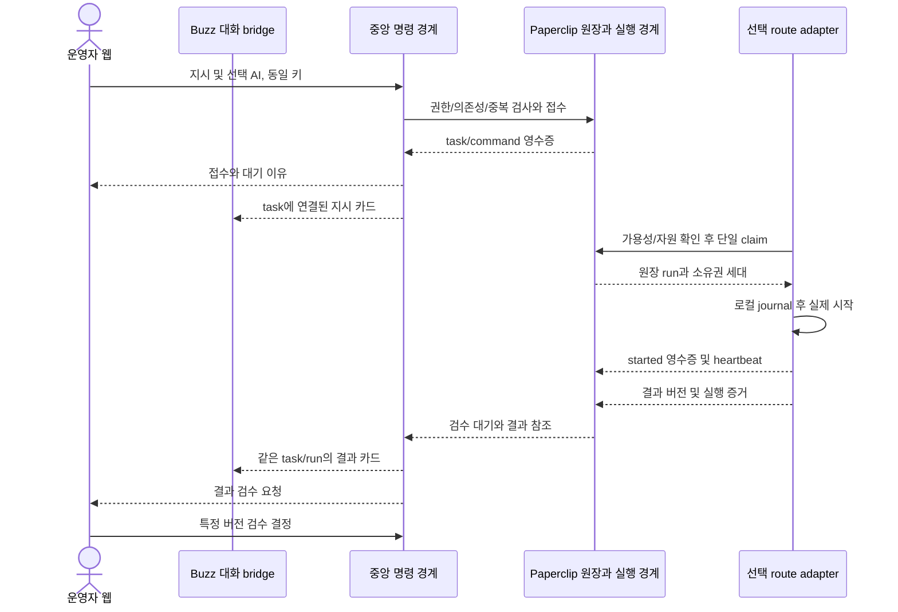

# 기술설계 TDD: HAAR Workspace

버전 0.1 / 2026-10-16. TDD는 이 문서에서 Technical Design Document를 뜻한다. **[확정] 제품 요구는 [PRD](PRD.md), 나머지는 검증 전 기술 제안**이다. 실제 설치·실행·성능·API 호환성을 확인한 구현 명세가 아니다. [데이터/API/MCP 명세](DATA_API_MCP_SPEC.md), [보안설계](SECURITY_APPROVALS.md), [구현계획](IMPLEMENTATION_PLAN.md)을 함께 읽는다.

## 1. 구성과 책임

| 구성 | 책임·소유 데이터 | 경계·검증 과제 |
| --- | --- | --- |
| 반응형 웹/BFF 후보 | 인증된 화면·사용자 명령·접수/조회 표현 | iPhone과 Mac은 같은 자원 사용, 프런트 상태를 원장으로 삼지 않음 |
| Task Core bridge | Paperclip issue·배정·상태·checkout/run 조회 및 변경 경로 | 원장 로직 재사용, 직접 DB 우회 수정 금지, 정확한 확장/plugin/API 수단 M0 선택 |
| HAAR 확장 저장 | SKU·artifact version·검수·집중·지침/기억/스킬·action 승인·ID 매핑 | 추가 속성만 권위 소유, task 상태는 조회 투영. DB 배치/스키마 미확정 |
| Buzz channel bridge | 선택 route 지시·결과 대화, 인증된 메시지↔task/run 연결 | 메시지 원장과 작업 원장을 구분, 다른 AI로 자동 라우팅 금지 |
| 내구성 dispatch/회복 경계 | 원장 소유권과 연결된 전달·ACK·중복 방지·실행 슬롯 | 별도 독립 scheduler 2개가 같은 task를 시작하지 않게 설계 |
| 실행 adapter/node | 다섯 경로의 capability·로컬 journal·실행/조회·결과 | 각 route의 실지원 확인, 이미지/영상/브라우저는 지정 노드 |
| credential broker/helper | 로컬 로그인·허용 외부 요청·영수증 | 비밀을 중앙 DB/모델/로그에 복사하지 않음 |

이 구분은 논리 경계다. 서비스마다 프로세스·DB를 새로 늘린다는 뜻이 아니다. 중앙 메모리 예산에 맞춰 최소 프로세스·기존 원장 저장소 재사용 가능성을 우선 검증한다. 실제 Paperclip/Buzz 배치와 설치 상태는 미확인이다.

## 2. 실제 Paperclip 로직 재사용

고정 커밋 `b294abb9eb96c33048b4f53a2a037e04886b7407`의 일부 코드를 읽기 전용으로 추적했다. [기술 검토의 CR-01~07](TECHNICAL_REVIEW.md#22-읽기-전용-코드-조사-결과)를 코드 근거로 사용한다. 소스 정적 확인은 전체 보안 감사·호환성 시험·실서버 검증을 대신하지 않는다.

| 로직 | 재사용할 경계 [제안] | HAAR에서 추가할 것 | 관문 |
| --- | --- | --- | --- |
| 작업 배정/변경 | routes 권한 검사와 issue service 갱신 경로 | route↔agent 매핑, 사용자 UI의 P0~P3와 upstream priority 변환, 확장 revision | CR-01/02, AC-03/13/23 |
| checkout | expected status·assignee·execution lock을 검사하는 조건부 갱신과 충돌 처리 | 원격 실제 시작 확인, 자원 예약, 실제 결과 불명 시 재실행 hold | CR-02, AC-08/10/11 |
| 큐/실행 수명주기 | heartbeat queue·lifecycle 및 원장 run/event 기록 | 원격 journal/ACK·late result·source idempotency와 fencing 계약 | CR-03/04, AC-07/09/21 |
| issue/run schema | company·issue/run ID·status·소유권·실행/로그 참조 | SKU·focus·artifact/approval·기억/스킬 snapshot 매핑 | CR-05/06, AC-05/12/16 |
| 조립 서비스 | heartbeat가 queue/lifecycle을 연결하는 구조 | 지원되는 확장 지점으로 원격 adapter 삽입 가능한지 스파이크 | CR-07, AC-23 |

중요한 차이: upstream checkout이 기록하는 `startedAt`/`in_progress`, 내부 큐의 `running`은 HAAR 원격 프로세스 시작을 입증하지 않는다. 화면의 ‘실행 중’에는 adapter의 실제 started 영수증이 필요하다. HAAR `revision`도 upstream `statusVersion` 전체와 같은 필드가 아니다. 세부 매핑은 데이터 명세를 따른다.

upstream의 terminal/missing run 정리·stale adoption은 원격 외부 행동의 미실행 증거가 아니다. 직접 지시 출시 전 **unknown 결과를 재실행하지 않는 hold를 모든 자동 wake/회복 경로에서 강제할 수 있는지** 검증한다. 지원 확장점이 없으면 작은 patch·포크 비용을 비교하거나 해당 경로의 직접 실행을 보류한다. 기존 로직을 이름만 바꿔 독립 scheduler로 다시 작성하지 않는다.

## 3. 지시에서 결과까지

이는 논리 시퀀스이며 native Paperclip 엔드포인트를 그대로 의미하지 않는다. 위의 adapter→원장 접점은 Task Core/dispatch 경계를 통해 인증·인가된다. 채널에서 시작하면 B→C로 들어오며 웹에서 시작한 지시를 B에 표시했다는 이유로 같은 명령을 재접수하지 않는다.

원장 변경과 HAAR 추가 저장을 같은 트랜잭션으로 묶을 수 있는지는 미확인이다. 가능하면 동일 트랜잭션+outbox, 별도 시스템이면 durable command receipt·동일 키 재조회·보상/재조정 상태를 사용한다. 미확인 응답에서 새 ID를 생성해 성공을 추측하지 않는다. ‘접수됨’은 권위 있는 접수 기록 이후만 표시하며 양쪽 반영 대기 상태를 관측 가능하게 한다.

## 4. 데이터 흐름과 읽기 모델

작업 상태·배정·원장 run은 Paperclip에서만 확정한다. UI 집계·검색용 projection은 원장 ID·버전·이벤트 cursor로 갱신하며 재구축 가능해야 한다. Buzz는 메시지·스레드, HAAR 확장은 상품·검수·승인·메모리의 권위 경계다. 화면의 복합 조회는 값별 원천·갱신시각을 보존한다.

예: ‘승인본을 사용한 SNS 게시’는 artifact의 approved version → action digest → 사람 승인 → 외부 영수증을 연결한다. 생성 run의 성공과 artifact 승인·게시 성공을 하나의 boolean으로 합치지 않는다. snapshot에는 적용 지침·스킬·기억 revision을 고정하고 새 결정은 다음 run 또는 명시적 중단/재개를 통해 적용한다.

## 5. 다섯 route와 프로토콜

route 목록과 미확인 명칭은 PRD 10.1절을 기준으로 한다. 구현 인터페이스는 hello/capabilities, execute, query_run, cancel, event/ACK, artifact 결과, 필요 시 query_external_action으로 나눈다. 지원하지 않는 항목은 false/확인 필요로 신고한다. [adapter 계약](ADAPTER_CONTRACT.md)의 식별자·lease·journal·재연결 규칙을 단일 기준으로 사용한다.

Mac의 outbound long polling은 초기 후보, WS는 대안이다. Buzz의 WS 사용과 Mac dispatch 운송 방식은 별개의 결정이다. GPT가 기존 웹 대화인지 API인지 확인되지 않았으므로 계약 없는 GUI 자동화를 필수 의존성으로 넣지 않는다. 수동 인계 상태는 개발 대상의 임시 대안이며 다섯 adapter 구현 완료를 뜻하지 않는다.

## 6. 경량 중앙·관측·복구

부하 공식·비교 방식과 Rust의 미확정 상태는 [ADR-001](ADR-001-LIGHTWEIGHT-RUNTIME.md)을 유지한다. 메모리 예산표에는 실제 RAM, 중앙/DB/relay/cache peak, 같은 호스트 adapter·자식 프로세스 peak, OS·기존 서비스 예약, 안전 여유, 측정 조건을 기록한다. 수치는 아직 공란이며 문서의 전역 1개·노드 1개는 초기 비교 제안이다.

슬롯·메모리 부족은 대기로 남기고 중앙 연산 fallback은 금지한다. 이미지 원본·전체 로그를 중앙 메모리에 일괄 적재하지 않고 권한 있는 참조·페이지 조회·제한된 버퍼/결과 크기를 사용한다. 보존·pool·연결·큐 상한은 M0 측정 후 설정하며 큐 포화 시 명확한 backpressure를 반환한다. control 경로와 무거운 실행 슬롯을 분리해 중단·heartbeat·결과 수신을 유지한다.

관측은 command/task/run/action/source ID, projection cursor, 소유권 세대, 실제 started, 마지막 heartbeat, 자원 대기, 승인·영수증을 연결한다. 원문·credential은 기록하지 않는다. 실패별 복구는 adapter 계약 7절, 승인 사고는 보안설계 7절을 기준으로 한다. 복구·backup이 이미 실행된 외부 행동을 새 작업으로 재생하지 않게 멱등성 ledger·승인 소비·cursor를 함께 복원한다.

## 7. 통합·업그레이드와 논의할 선택

MIT/Apache 고지·NOTICE·전이 의존성·lockfile·보안 패치·migration/rollback은 [기술 검토 3절](TECHNICAL_REVIEW.md#3-라이선스의존성업데이트-전략-제안)을 따른다. Argo의 공개 기억/인계·카드/스킬 UX는 독자 구현하며 코드를 도입하거나 미확인 API를 필수로 삼지 않는다.

| 결정 ID | 선택지와 권고 방향 [제안] | 결정 전 증거 |
| --- | --- | --- |
| TECH-01 | Paperclip 지원 확장/plugin/API 우선 / 필요한 최소 포크 patch | 배정·checkout·unknown hold가 모두 같은 권위 경계에서 강제되는지 |
| TECH-02 | Buzz relay/API 경계 재사용 / 채널 모듈 일부 추출 | 인증·서명·검색·ID 매핑, 의존성 포함 peak와 유지 비용 |
| TECH-03 | 기존 언어 bridge / 경량 Rust adapter / 전체 Rust 재작성 비교 | ADR-001 동일 부하 측정·upstream 재사용/업데이트 비용 |
| TECH-04 | Mac long polling 우선 / WS | 절전·복귀·재연결·idle 사용량·운영 복잡도 |
| TECH-05 | 원장 DB와 확장 같은 트랜잭션 / 별도 저장과 durable 재조정 | 공식 확장 지원·migration 경계·부분 실패 회복 시험 |

선택지는 사용자와 검토할 사항이며 이 문서가 스택·배포 승인을 대신하지 않는다. 미확인 API·설치·지원 가정과 담당은 데이터 명세의 V-01~08, 구현계획의 M0 관문으로 추적한다.
