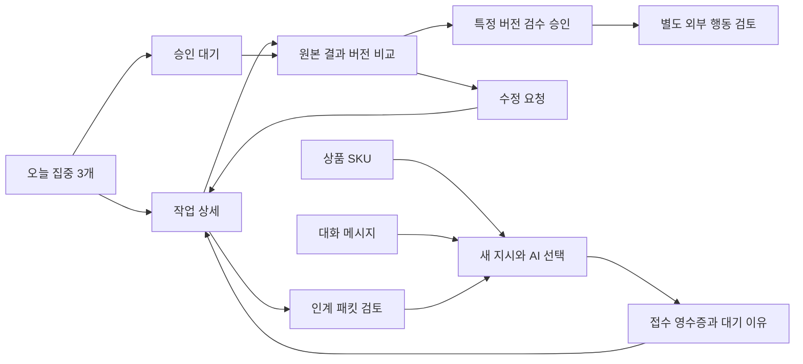

# 유저저니·화면설계

버전 0.1 / 2026-10-16 / 검토용 설계. **[확정]**은 [PRD](PRD.md)의 제품 합의이며, 아래 배치·전환·문구는 별도 표시가 없으면 **[제안]**이다. 실제 화면·디자인 파일·앱이 구현되었다는 뜻이 아니다. 화면의 필수 데이터는 PRD 7절, 상태는 8절을 기준으로 하고 여기서는 여정과 상호작용을 구체화한다.

## 1. 여정과 진입 경로

| 여정 ID / PRD 흐름 | 시작 → 핵심 전환 → 종료 | 사용자 판단 | 연결 AC |
| --- | --- | --- | --- |
| J-01 / F1·F6 | 오늘 → 전체 우선순위/마감 → 집중 선택·순서 → 작업 상세 | 긴급 작업이 들어오면 기존 3개 중 무엇을 교체할지 | 01~04, 14 |
| J-02 / F2 | 상품 또는 오늘 → 새 지시 → 원본·검증 사실 → AI 선택 → 접수 → 실행 상세 | 어떤 SKU/버전과 AI에 어떤 결과를 맡길지 | 06~11, 17, 23~24 |
| J-03 / F3 | 승인 대기 → 원본/결과 비교 → 수정요청 또는 검수 승인 → 승인본 | 제품과 결과가 일치하며 어느 버전을 채택할지 | 05~06, 12~14 |
| J-04 / F4 | 작업 → 인계 패킷 → 대상 AI 선택 → 기존 실행 확인 → 새 실행/자식 작업 | 같은 일의 인계인지 독립 시안인지 | 08, 10~11, 15~17, 23 |
| J-05 / F5 | 대화 → 메시지 선택 → 기록 연결 또는 작업 지시 → 상세/결과 회신 | 기록과 실행을 명시적으로 구분 | 07, 13, 17, 21, 23 |
| J-06 / F3·F7 | 승인본 → 외부 행동 초안 → 대상/내용/비용 검토 → 승인 → 실제 영수증 | 결과 채택과 외부 효과를 별도로 판단 | 18~19, 22 |

J-06의 자동 외부 실행은 M3 이후 선택 서비스의 계약·승인 강제 검증 후 제공한다. M1/M2는 승인본과 수동 실행 증거 기록까지만 지원한다. 실제 운영 계정 게시·CS 발송·예산 변경의 시험도 별도 구체 승인이 필요하다.

## 2. 화면 ID와 탐색

화면 ID는 PRD의 S1~S8을 유지한다. 세부 단계는 S2a처럼 구분한다. 모바일의 오늘·작업·승인·더보기와 데스크톱의 상세 메뉴는 같은 ID/URL로 연결한다. 새 알림을 열 때는 원래 목록의 필터·스크롤·선택 상태로 돌아갈 수 있게 한다. deep link가 권한 밖이면 자원 존재나 제목을 노출하지 않는다.

| 화면/구역 | 배치·주요 조작 | 나가기/복귀·권한 |
| --- | --- | --- |
| S1 오늘 | 집중 3개 → 마감/우선순위 → 승인 대기 → 막힘 → 진행 그래프, 요약에 마지막 갱신 시각 | 카드에서 S2/S3/S7, 그래프에서 필터된 목록. 숫자 집계는 원장 기준 |
| S2 작업 목록 | 목록 우선, 보드/마감 보기 전환, SKU·영역·담당/상태 필터 | 저장된 조회 조건 유지. 다른 화면에서 돌아와도 같은 task 선택 |
| S2a 새 지시 | 목표·수용조건·SKU/원본 → AI 선택 → 전송 전 요약, 긴 입력은 초안 저장 | 취소 시 초안 보존 선택, 전송 중 반복 탭은 같은 명령 키 |
| S2b 작업 상세 | 목표·다음 행동·상태·마감, 지시/실행/산출물/결정/의존성, 실행 시작/중단 영수증 | 원본 메시지·SKU·AI 카드로 이동. 미지원 동작은 이유와 대안 표시 |
| S3 상품/결과 | SKU/변형 → 최신 생성/승인본 → 버전 비교·검수 체크 → 수정 또는 승인 | 모바일은 위/아래 비교, 데스크톱은 나란히 비교. 검수 전 원본/버전 접근 검사 |
| S4 대화 | 채널/스레드와 선택 AI, 지시/기록 구분, 접수/진행/결과 카드 | 미등록/동명 AI는 임의 선택 금지, task/run 링크로 결과 귀속 확인 |
| S5 AI 카드 | 역할·사용자 지침/스킬 버전·MCP 권한·route·기기·연결/진단 | COKACDIR는 확인된 명칭으로 표시하고 버전·세션 연동 API는 미검증으로 표시. Orca 제품명·GPT 호출도 확인 필요 |
| S6 기억/스킬 | 출처·범위·수정일·후보/승인 버전·차이·평가·롤백 | 후보의 권한 변화 별도 검토. run 스냅샷은 기존 버전 유지 |
| S7 승인/복구 | 검수와 외부 행동 분리, 미리보기·계정/범위·비용·만료·결정 | 승인권한 없으면 조회 범위만 제공. unknown 결과에는 재실행 대신 조회/증거 등록 |
| S8 설정/접근성 | 계정·route 연결·권한 철회·알림/시간대·기기 진단 | credential 입력은 로컬 helper로 안내; 중앙 입력 폼에서 비밀을 수집하지 않음 |

화면의 내부 로그/lease 같은 구현 필드는 실행 상세의 진단 구역에 둔다. 사용자 주 흐름에는 ‘누가·어디서·왜 대기·다음에 무엇’이 먼저 보인다.

## 3. 핵심 상호작용 상세

### 3.1 집중 선택과 마감

최대 3개와 수동 순서는 확정이다. 집중 선택은 작업 상태를 바꾸거나 AI를 실행하지 않는다. 네 번째 항목은 ‘교체할 일 선택’으로 이어지고 기존 선택·마감을 보여준다. AI 추천은 이유와 함께 채택 버튼을 제공한다. 기한은 날짜만/정확한 시각/없음을 구분해 저장 방식 확정 전 사용성 검토를 한다. 표시에는 사용자 시간대를 함께 확인할 수 있어야 한다.

### 3.2 지시와 AI 선택

AI 선택 카드는 VPS Hermes·OpenClaw, Mac COKACDIR·Orca, GPT의 다섯 route를 대상으로 하지만 **개발 대상**과 **현재 실행 가능**은 구별한다. Hermes·OpenClaw는 사용자 확인 대상이며 설치·API 지원은 별도 검증한다. 카드에는 제품명 확인 상태·기기·연결·지원 capability·대기 이유를 보인다. 연결된 다른 AI로 자동 바꾸지 않는다. 오프라인 대상에도 중앙 접수는 가능하되 실행 대기를 표시하고, 취소/다른 대상으로 재지시 시 기존 실행 여부를 먼저 확인한다.

전송 전 요약에는 목표·SKU/변형·원본 버전·선택 AI·허용 효과·기한·필요한 검수를 표시한다. 초안 생성에 외부 쓰기 권한을 포함하지 않는다. 결과는 대화의 한 메시지뿐 아니라 S2/S3의 버전 자원으로 연결한다.

### 3.3 검수와 수정

검수자는 보이는 정확한 버전을 승인한다. ‘최신’ 링크만으로 승인하지 않는다. 이미지 형태·색상·디테일, 상품 사실 근거, 영상/캡션의 일치를 확인하고 체크 누락·접근 불가·digest 변경이면 승인 불가 사유를 표시한다. 수정요청은 프레임/영역/문장과 사유를 담고 다음 버전을 생성한다. 수정 완료 알림이 과거 승인본을 바꾸지는 않는다.

### 3.4 중단·인계·복구

‘중단 요청’ 뒤에는 수신 확인과 실제 종료 확인을 구분한다. 이미 발생한 외부 효과는 지워지지 않는다. 인계 미리보기는 목표·완료/미완료·근거·결정·금지사항·다음 행동을 보여주고 새 AI 권한은 별도 검사한다. 연결 단절·unknown은 실행 상세의 조회/복구로 연결하며 ‘다시 실행’ 단일 버튼으로 처리하지 않는다.

## 4. 공통 상태와 문구

| 관측 상태 | 사용자 표시 [제안] | 가능한 다음 행동 |
| --- | --- | --- |
| 최초 데이터 없음 | ‘오늘 집중할 일을 골라주세요’ / ‘연결된 결과가 없습니다’ | 작업 선택·원본 연결, 가짜 완료/그래프 없음 |
| 접수 성공·미시작 | ‘지시를 접수했습니다’ + command 참조 | 상태 조회·미시작 취소 |
| offline / 자원 부족 | ‘Mac 연결 대기’ / ‘실행 자원 대기’ | 대기 이유·마지막 확인·명시적 변경 |
| checkout 후 실제 started 전 | ‘시작 준비’ | started 영수증 대기 |
| 실제 started 확인 | ‘실행 중’ + 위치·최근 heartbeat | 진행·중단 요청 |
| 실행 완료·검수 전 | ‘결과 검수 대기’ | S3 비교·수정·특정 버전 승인 |
| 결과 불명 | ‘실제 완료 여부 확인 필요’ | 기존 run/action 조회·담당자 증거 확인 |
| stale 편집/승인 버전 | ‘내용이 변경되어 다시 확인해야 합니다’ | 새 revision 비교·재검토, 자동 덮어쓰기 없음 |
| 네트워크 단절/권한 거부 | ‘연결을 확인해 주세요’ / ‘이 작업에 접근할 권한이 없습니다’ | 초안 보존·재조회/담당자 연결, 자동 승인 재전송 없음 |

실행 상태와 화면 로딩은 다르다. 조회가 실패하면 과거 데이터를 최신처럼 보여주지 않고 마지막 확인 시각·갱신 실패를 표시한다. 접근성·375px·44px 등 기존 수치 목표는 PRD의 제안이며 실제 기기에서 검증한다.

## 5. 사용자와 논의할 화면 선택지

| 결정 ID | 선택지·권고안 [제안] | 확정할 영향 |
| --- | --- | --- |
| UX-01 | 홈 ‘집중 3개 우선’(권고) / 승인함 우선 | 자주 쓰는 첫 진입. 집중 3개·승인 대기 자체는 유지 |
| UX-02 | 모바일 하단 ‘오늘·작업·승인·더보기’(권고) / 대화를 고정 메뉴로 추가 | 이동 중 지시 빈도와 탐색 단계 |
| UX-03 | 새 지시 때 SKU·목표 후 AI 선택(권고) / AI를 먼저 선택 | 잘못된 대상·원본 누락 방지와 전송 속도 |
| UX-04 | 모바일 결과 위/아래 비교(권고) / 원본↔결과 빠른 토글 | 작은 화면의 제품 디테일 검수 |
| UX-05 | 대화 안 결과 카드+작업 상세 연결(권고) / 대화와 상세를 분할 패널 | Mac에서 병행 검토하는 방식 |

권고안은 사용자가 확정한 UI가 아니다. 문서 검토 시 선택·이유를 남기고 AC-01~06, 14, 17, 23의 여정을 간단히 확인한 뒤 설계를 고정한다. 이번 문서 작성은 답변을 기다리지 않고 가능한 제안을 완성하며, 이 선택을 근거로 앱을 구현하지 않는다.
